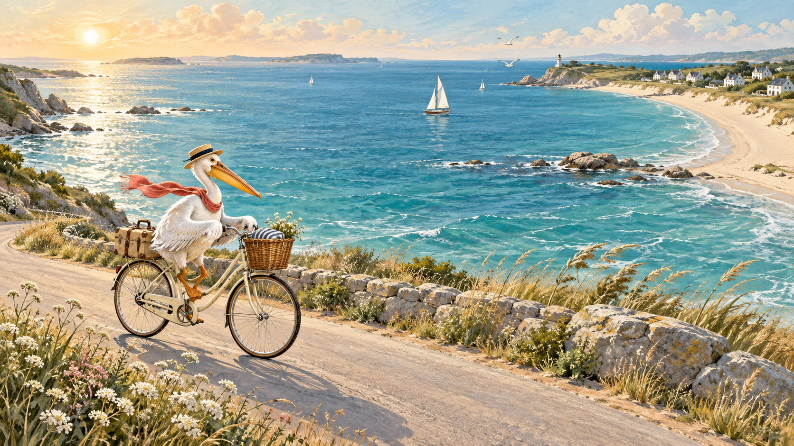
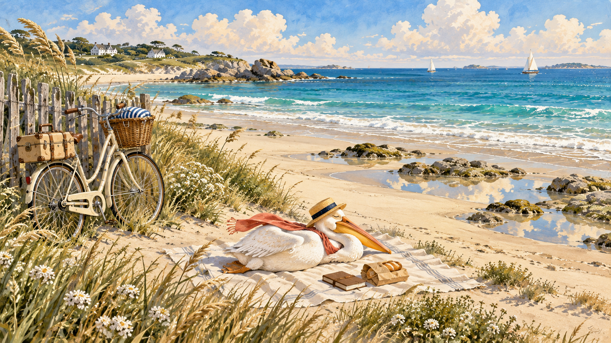
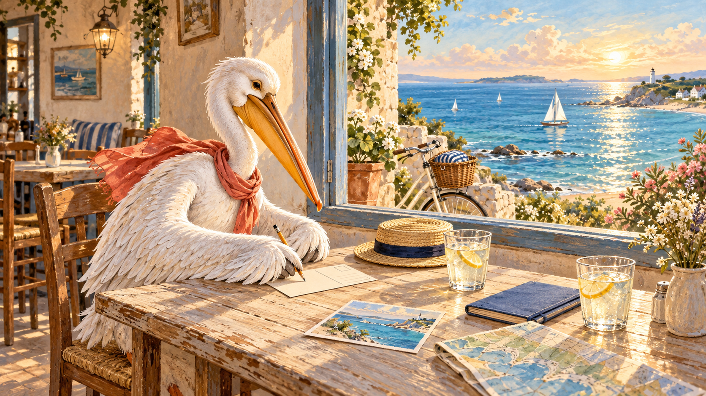
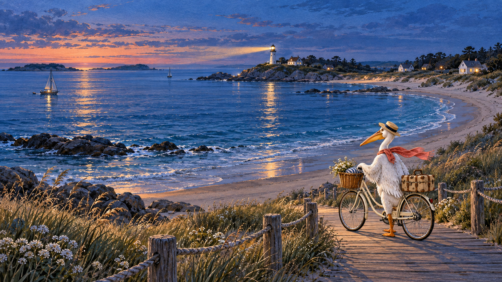

# 把夏天骑进海风里

*A Summer Carried by the Sea Breeze*

那年夏天，我在海边遇见一只旅行的鹈鹕。它有一辆奶油色的旧单车，一只绑在后座上的小皮箱，还有一条被太阳晒淡了的珊瑚色围巾。我们认识的时候，天刚亮，它正停在路口，低头研究一张被海风折来折去的地图。

地图的边角已经起毛。通向码头的路旁，画着一枚小小的贝壳；通向山坡的路上，圈着一个像太阳的圆。只有出发的日期，没有返程的日期。

“你要去哪里？”我问。

它扶稳草帽，望了一眼海：“先往有风的地方骑。”

## 一、清晨，把行李交给风

小镇醒得很慢。面包店的卷帘门刚拉到一半，第一盘面包便把温热的气味送进巷子。有人在门前洗一张折叠椅，水沿着石缝流下去，一路闪着细小的光。鹈鹕买了两只圆面包，把其中一只递给我。面包还烫，纸袋被黄油洇出一块透明的浅金色。

它的行李比我想象中少。一件雨衣，一本蓝色封面的笔记本，一支铅笔，一只搪瓷杯，几张没有寄出的明信片。皮箱里最占地方的，是一条能铺在沙滩上的旧毯子。它说，有时候遇见一片好看的云，就得坐下来等一会儿；如果没有毯子，等云这件事便显得不够郑重。

我推着自己的车跟上它。车轮压过石板路，发出轻轻的磕碰声。经过最后一排房子时，海突然出现在我们面前，宽得让人忘记刚才那条窄巷。早晨的光贴着水面，像有人把一张银色的纸缓缓展开。鹈鹕没有说话，只把围巾往后拨了拨，开始认真地蹬车。

*We left before the town had finished waking. The bread was warm, the road was empty, and the sea appeared beyond the last white house. For a while, the sound of our wheels was the only thing we added to the morning.*



## 二、一辆单车，借来整条海岸

沿海的路并不笔直。它绕过岩石，钻进树荫，又从一簇野花后面伸向亮处。海有时在左边，有时藏到身后；等我们拐过弯，它又安静地等在前面。鹈鹕很喜欢这些弯道。它总在快要看见下一段路时放慢速度，仿佛不愿一下子把风景翻完。

骑到一座矮桥上，它忽然停下来。桥下有几条小鱼，贴着水草逆流而上。一只空木船系在岸边，船底积着昨夜的雨。鹈鹕看了很久，把面包纸袋叠成一个小方块，收进口袋。我以为它要记下什么，它却只是伸了伸被车把压酸的翅膀。

“刚才那段下坡，真好。”它说。

我回头看，路已经被树挡住了。那段下坡没有名字，也不在地图上的任何圆圈里。可我记得风从耳边往后跑，记得影子突然拉长，记得它的草帽差一点飞起来时，我们同时笑出了声。以后如果有人问起这次旅行，我大概会先想起这里。

我忍不住问它，明明有一双翅膀，为什么偏偏要骑车。它把车停在路肩，抬头望了望几只飞过的海鸟。“在天上的时候，我总看得很远。”它说，“可是这回，我想知道海边的花是什么气味，想看清别人窗台上放着什么。还想试试看，一段路用脚慢慢走完，会是什么感觉。”

正说着，前面院子里有人提着水壶出来，问我们要不要添一点水。鹈鹕赶紧打开车篮。那个人和它聊起风向，说过了午后，去灯塔最好走靠山的那条路。等我们再上车，水已经添满，地图上也多了一条新画的线。鹈鹕看着我，像是刚才那个问题，已经有了一个更好的回答。

临近中午，我们把想去的地方写在笔记本上。没有精确的时间，也没有必须完成的安排。鹈鹕在最后一格补了一行字，把纸页推给我看。

| 想停一停的地方 | 准备做的事 | 留给自己的时间 |
| --- | --- | --- |
| 小镇面包店 | 带上热面包，等街道醒来 | 一个早晨 |
| 白沙湾 | 看潮水，捡一枚完整的贝壳 | 直到想走 |
| 山坡灯塔 | 骑上最后一段缓坡 | 日落以前 |
| 没有名字的路口 | 拐进去看看 | 可以改变计划 |

我习惯把路线存成短短的几行代码，也就顺手抄在了那页行程后面。等下一次出发，换几个地名，这段小程序还可以用。

```javascript
const stops = ["面包店", "白沙湾", "山坡灯塔"];
const postcards = stops.map((place, index) => ({
  stop: index + 1,
  destination: place,
  reminder: "留一点时间，给没有安排的风景"
}));
console.table(postcards);
```

鹈鹕看不懂代码，却认出了里面那句提醒。它用铅笔轻轻敲了敲纸边，说这句可以留着。

## 三、沙滩上的空白，刚好够坐两个人

白沙湾在一条岔路的尽头。我们把单车靠在木栅栏上，脱了鞋，踩进细沙里。表面是热的，再往下半寸却有一点凉。潮水刚刚退去，留下许多浅浅的水洼，云的碎片就躺在里面。鹈鹕提着鞋走得很小心，尽量绕开那些小小的天空。

它铺开毯子，压上四块圆石头。我们坐下来分最后一只面包。远处有孩子跑进海里，又被一道不高的浪赶回来；遮阳伞下面，一个老人把收音机的声音调得很低。那支歌我没有听过，听起来却像从很久以前的夏天传来。鹈鹕把帽子盖在脸上，没过多久，呼吸就和海浪一起慢了下来。

我本来想写一段很长的旅行记录。可是铅笔拿在手里，最后只写了几件小事：今天的海有三种蓝；沙子钻进了鞋的缝线；午后的风吹到这里，会先经过一片松林。写完以后，空白还剩很多。我把本子合上，用手背碰了碰它晒热的封面。

等鹈鹕醒来，毯子旁边多了一枚完整的贝壳。它拿起来看，壳口朝着太阳，里面透出淡淡的粉。我们没有把它装进皮箱，只挪到靠近水的一块石头上。下一次涨潮时，它就可以顺着水回去了。



## 四、把没有说完的话，写成一张明信片

午后我们找到一家临海的小咖啡馆。窗很大，窗框上的白漆有几处剥落，露出木头原来的颜色。老板端来两杯柠檬水，杯壁上很快结满水珠。鹈鹕把明信片摊在桌上，挑了画着灯塔的那一张，写了一个开头，又停下来望海。

它说，出门以后，总觉得有很多话可以寄回去，真正拿起笔，却常常不知道从哪一句开始。我说，可以告诉收信的人，今天午饭吃了什么，车胎有没有漏气，或者路边有一只猫，在我们靠近时甚至懒得睁眼。它想了一会儿，慢慢写下：“这里的风很大，我把帽子抓得很紧。你上次给我的那条围巾，刚好用得上。”

写完这一句，后面便顺了。它说起面包店、矮桥和不知名的下坡，说沙滩上有一支听不清的老歌。我坐在对面，看它一行一行把今天收拢，忽然觉得，所谓纪念，大约也不必把一切留住。有几处温热的细节，够我们以后循着它们，走回这一天下午。

*Dear friend, the wind is stronger here than I expected. Your scarf has been useful. We found a beach with hardly any footprints, and a café where nobody hurried us. I wish you could have shared the last piece of bread.*



## 五、日落以前，还有一段缓坡

离开咖啡馆的时候，太阳开始偏西。去灯塔的路缓缓往上，两边长着被风吹矮的灌木。骑到一半，鹈鹕下车推行。我也跟着停下来。后座的小皮箱随着步子轻轻摇晃，里面的铅笔大概碰到了杯子，隔一会儿便响一声。

我们走得慢，看见的东西反而多了：石缝里开着很小的白花，一只蜥蜴迅速藏进墙后，有人用旧贝壳给院门做了一串风铃。风铃不怎么响，只有一阵恰好的风穿过去，才短短地碰两下。鹈鹕站在门外听了一会儿，像在等一句话的结尾。

到坡顶时，灯塔还没有亮。海面已经变成温柔的灰蓝色，远处的船留下一条慢慢散开的航迹。我们把车并排停好，坐在低矮的石墙上。今天绕过的海湾，现在只剩下很细的一道弧线。我试着从那条弧线上找到白沙湾，找到咖啡馆那扇大窗，最后只能指着一个大概的方向。

鹈鹕没有替我纠正。它只是望着那边，轻轻说了一声：“我们今天骑了很远呢。”

其实里程并不长。可太阳从我们的前方，慢慢走到了身后；早晨还陌生的路，现在已经有了回忆。灯塔亮起第一圈光时，它把那张明信片仔细放进车篮，准备下山后投进邮筒。

*By evening, the road behind us had become a place we knew. There was no need to count the miles. We could name the bend where the hat nearly flew away, the bridge with the empty boat, and the patch of shade where we had stopped to drink.*

## 六、夜色合上，夏天还留着一页

回到海湾时，沙滩上已经很安静。白天的脚印被潮水抹去了大半，几盏小灯沿着木栈道亮着。我们推着单车走过最后一段沙路，轮胎陷下去，留出两条歪歪的细线。鹈鹕把鞋挂在车把上，光着脚，像是还不愿这么快结束今天。

它终于把明信片投进了邮筒。金属盖板落下，轻轻响了一声。那一刻，今天有很小的一部分离开了我们，开始去往另一个地方。我想象几天以后，有人从信箱里取出这张卡片，指尖摸到它的边角；那个人未必来过这里，却会知道，在这个夏天，有一只鹈鹕骑着单车，认真地想起过自己。

旅馆的窗留着一道缝。夜风吹进来，掀动桌上的地图。我把笔记本翻到新的一页，写下日期，又把铅笔放在中间。隔壁传来鹈鹕整理皮箱的声音。过了一会儿，它敲敲墙，问明天要不要再往北骑一点。

我说，好。

外面，最后一束灯塔的光正缓慢地经过海面。它照亮水，照亮一只停泊的船，也短暂地照亮窗边两辆单车的车铃。光移过去以后，铃铛又安静下来。明天还有很长的白昼，我们不必现在就把路想完。



*Tomorrow, perhaps, we will ride a little farther north. Tonight, the bicycles rest by the window, and the sea keeps turning its pages.*
